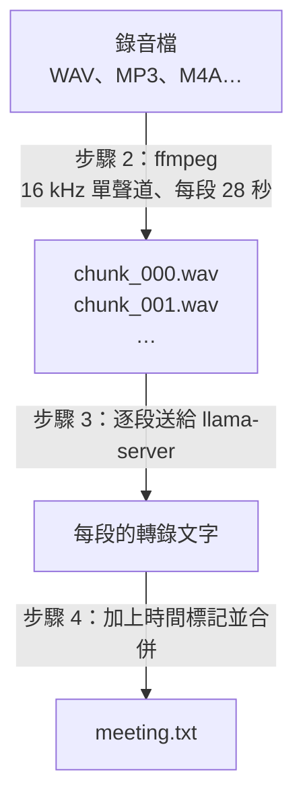

會議錄音、訪談、語音筆記常常包含不適合上傳到雲端的內容，但要在本機做語音辨識，過去通常得另外架設一套專用模型。 Google 的 [Gemma 4 model card](https://gemma.ai/models/gemma-4/model-card/) 改變了這件事：最小的 E2B 與 E4B 本身就[訓練過多語言語音辨識](https://gemma.ai/get-started/capabilities/audio/)，同一個模型既能聽寫，也能接著整理內容。本文以 [`llama.cpp`](https://github.com/ggml-org/llama.cpp) 的 `llama-server` 在本機提供 OpenAI 相容的 API ，再用 TypeScript 寫一支命令列工具，把任意長度的錄音檔轉成逐字稿，錄音內容全程不離開你的電腦。

> 本文的指令與數據於 Windows 11 、 RTX 3060 Ti 8 GB 、以 `winget` 安裝的 `llama.cpp` （ Vulkan 版， build 12199 ）上驗證。

## 哪些版本能處理語音

並非所有 Gemma 4 都能接收音訊。根據 [Gemma 4 model card](https://gemma.ai/models/gemma-4/model-card/) ，只有 E2B 、 E4B 與 12B Unified 支援音訊輸入， 26B A4B 與 31B 則沒有這項能力。

`llama.cpp` 的[多模態文件](https://github.com/ggml-org/llama.cpp/blob/master/docs/multimodal.md)目前將 E2B 與 E4B 列為支援音訊的模型，所以本文以這兩個版本為主。本文使用 Google 官方發布的 [QAT Q4_0 GGUF](https://huggingface.co/google/gemma-4-E4B-it-qat-q4_0-gguf)。 QAT （量化感知訓練）指模型在訓練階段就考慮了 4 位元量化，比訓練完才量化的版本更能保留原本的準確度。模型本體之外，還需要處理音訊與圖片的 mmproj 檔：

| 版本 | 模型（ QAT Q4_0 ） | mmproj | 實測記憶體占用 | 適合的環境 |
|------|--------------------|--------|----------------|------------|
| E2B | 3.35 GB | 0.99 GB | 約 2.7 GB VRAM | 一般筆電，或要同時執行其他 GPU 程式 |
| E4B | 5.15 GB | 0.99 GB | 約 4.3 GB VRAM ＋ 3.5 GB RAM | 8 GB VRAM 顯示卡 |

> **提示：** 表格為 Hugging Face 標示的十進位 GB ， Windows 檔案總管以 1024 進位顯示，看起來會小約 7% 。另外， Windows 桌面本身也會占用部分 VRAM （筆者的環境約 2.4 GB ），載入 E4B 後 8 GB 顯示卡大約只剩 1.4 GB 。

以四段 TTS 產生的測試音檔實測， E2B 的平均字元錯誤率（ CER ）為 3.3% ， E4B 為 1.2% ，每段分別約 0.3 秒與 0.5 秒就能轉完。在 8 GB 顯示卡上，除非 VRAM 不夠，否則建議直接使用 E4B 。

## 為什麼不用 LM Studio

LM Studio 是在本機執行 Gemma 4 最方便的工具之一（用法請見  ），但截至本文撰寫時，它的[開發者文件](https://lmstudio.ai/docs/developer)與[更新紀錄](https://lmstudio.ai/changelog)都沒有提到將音訊傳給 Gemma 4 的方式，語音轉文字 API 仍是[尚未結案的功能請求](https://github.com/lmstudio-ai/lmstudio-bug-tracker/issues/1715)。模型支援音訊，不代表執行工具也支援。



能實際處理 Gemma 4 音訊的路徑主要有四條：

| 路徑 | 語言 | 需要後端 | 特點 |
|------|------|----------|------|
| `llama-server` （本文） | TypeScript 或任何能呼叫 HTTP 的語言 | 本機伺服器 | 使用量化模型， 8 GB VRAM 可執行 E4B ；相容 OpenAI SDK |
| [vLLM](https://docs.vllm.ai/) | 任何能呼叫 HTTP 的語言 | GPU 伺服器 | 適合多人同時使用，但 E4B BF16 約需 24 GB VRAM ，連 E2B 的 w4a16 版本也有 8.32 GB ，放不進 8 GB 顯示卡 |
| [Hugging Face Transformers](https://gemma.ai/get-started/capabilities/audio/) | Python | 無 | Google 文件的示範方式，但完整權重較大（ E4B 約 16 GB ） |
| [Transformers.js](https://github.com/kexi/gemma4-transcribe) | TypeScript | 無，於瀏覽器執行 | 透過 WebGPU 執行，首次下載 E2B 約 3.4 GB ，需要桌面版 Chrome 或 Edge |

本文選擇第一項：在 Node.js 環境就能開發，而且 API 格式和呼叫 OpenAI 幾乎相同，之後要換成 vLLM 等其他伺服器，只需要改連線位址。

## 啟動 llama-server

`llama.cpp` 是用 C/C++ 寫的本地 LLM 推論引擎，可以在自己的電腦上跑 GGUF 格式的模型（ Llama 、 Qwen 、 Gemma 等），不需要 Python 環境。用 `winget` 安裝就不用自己下載 zip 、解壓縮、設定 PATH 。

依[官方安裝文件](https://github.com/ggml-org/llama.cpp/blob/master/docs/install.md)安裝 `llama.cpp` ，並另外安裝 [ffmpeg](https://ffmpeg.org/download.html) ，後面切割音檔時會用到：

```bash
# Windows
winget install llama.cpp
winget install --id Gyan.FFmpeg -e

# macOS 與 Linux
brew install llama.cpp ffmpeg
```

- `winget` 是	Windows 內建的套件管理員（Windows Package Manager），類似 Linux 的 apt、macOS 的 brew
- `install`	子命令，用來安裝套件
- `llama.cpp`	是搜尋關鍵字， `winget` 會用它比對套件的名稱、ID 和 moniker ，這裡比對到的是 ID `ggml.llamacpp`



> 安裝完畢，試著使用上圖打勾的指令：
> - `llama-cli --version` 查詢目前安裝的 `llama-cli` 工具版本資訊
> - `llama-server --list-devices` 顯示當前系統中所有可供 `llama.cpp` 進行運算加速或模型卸載的硬體設備清單

接著啟動伺服器。第一次執行會從 Hugging Face 下載模型與 mmproj ：

```bash
llama-server -hf google/gemma-4-E4B-it-qat-q4_0-gguf -hff gemma-4-E4B_q4_0-it.gguf -c 8192 -np 1 --port 8080
```

**說明：**
- `-hf` 指定 Hugging Face 上的模型 repo ， mmproj 會一併自動下載。
- `-hff` 直接指定模型檔名，這個 repo 的檔名是 `gemma-4-E4B_q4_0-it.gguf` 。
- 顯示卡記憶體不足時可改用 E2B ： `-hf google/gemma-4-E2B-it-qat-q4_0-gguf -hff gemma-4-E2B_q4_0-it.gguf` 。較新的版本也可以用 `llama serve` 子指令啟動，參數相同。
- `-c 8192` 設定 context 長度。[預設值會沿用模型的上限](https://github.com/ggml-org/llama.cpp/blob/master/tools/server/README.md)，以 E4B 而言高達 128K ，會佔用大量記憶體。 8192 足以容納單段語音，也夠後面把逐字稿送回去整理摘要。
- `-np 1` 只開一個處理槽位。本文的程式逐段依序處理，不需要平行。
- `--port 8080` 指定監聽埠。各版本的預設值不同，明確指定可以避免後面的連線位址對不上。
- 若想在不用時釋放資源，可加上 `--sleep-idle-seconds 600` ：閒置 10 分鐘後卸載模型，下一個請求會自動重新載入，實測約多等 4 秒。

> 註：如果已經把模型下載到本機，可以改用 `-m` 指定模型路徑、 `--mmproj` 指定 mmproj 路徑，直接載入本機檔案，不必再經過 Hugging Face 。這種方式不會自動尋找 mmproj ，少了 `--mmproj` 就無法處理音訊：
>
> ```bash
> llama-server -m models/gemma-4-E4B_q4_0-it.gguf --mmproj models/gemma-4-E4B-it-mmproj.gguf -c 8192 -np 1 --port 8080
> ```

確認模型載入完成：

```bash
curl.exe http://localhost:8080/v1/models
```



> Windows PowerShell 5.1 的 `curl` 是 `Invoke-WebRequest` 的別名。若執行時會跳出＂Security Warning: Script Execution Risk＂的確認提示，則改打 `curl.exe` 呼叫 Windows 內建的 curl ，輸出的 JSON 會和其他平台相同。 `Invoke-RestMethod` 雖然也能呼叫，但會把 JSON 解析成 PowerShell 物件再顯示，巢狀欄位會被截斷成 `...` 。

注意：
1. 使用較新的 build ，因為 2026 年 5 月曾有一版 master 的 [KV cache 量化錯誤](https://github.com/ggml-org/llama.cpp/issues/23688)造成音訊請求失敗與輸出亂碼，已於數小時內修正。
2. 在 Windows 上安裝時，有兩個容易卡住的地方：
  - 找不到 `llama-server` 指令： `winget` 安裝後，已開啟的終端機不會讀到新的 PATH 。在 VS Code 的終端機裡執行時，要把整個 VS Code 重新啟動，只開新的終端機分頁並不夠。
  - 執行檔突然消失：部分防毒軟體會把 `llama-server.exe` 誤判而隔離，請到防毒軟體的隔離區自行還原，或把它加入例外清單。

## 實作轉錄工具

整體流程如下，步驟 2 至 4 依序實作這三個環節：



### 步驟 1：建立專案

```bash
mkdir gemma-llamacpp-transcribe
cd gemma-llamacpp-transcribe
npm init -y
npm pkg set type=module   # 啟用 ESM ，才能使用 top-level await
npm i openai
npm i -D tsx @types/node  # 直接執行 TypeScript
```

接著在專案根目錄建立 `tsconfig.json` ：

```json
{
  "compilerOptions": {
    "module": "nodenext",
    "types": ["node"],
    "noEmit": true
  }
}
```

**說明：**
- `tsx` 執行時不做型別檢查，這個檔案是給編輯器用的。
- `"types": ["node"]` 不能省略。 TypeScript 6.0 起 `types` 的預設值改為 `[]` ，不再自動載入 `node_modules/@types` 底下的套件。少了這行， VS Code 會在 `node:child_process` 等 import 上顯示「找不到名稱」（ ts2591 ）的錯誤。
- `"module": "nodenext"` 搭配 `package.json` 的 `"type": "module"` ，讓編輯器以 ESM 解析，接受 top-level await 。

### 步驟 2：切割音檔

Gemma 4 單段音訊的[上限是 30 秒](https://gemma.ai/get-started/capabilities/audio/#audio-data)，每秒佔用 25 個 token 。雖然 `llama.cpp` 的[前處理](https://github.com/ggml-org/llama.cpp/blob/master/tools/mtmd/mtmd-audio.cpp)會自動把長音訊分塊，但整段錄音會被塞進同一則請求，一小時的錄音就需要約 90,000 個 token 的 context ，輸出也無法逐段顯示。

此外，`llama-server` 只接受 [MP3 、 WAV 與 FLAC](https://github.com/ggml-org/llama.cpp/blob/master/tools/server/README.md#post-v1chatcompletions-openai-compatible-chat-completions-api) ，手機常見的 M4A 無法直接傳送。因此先用 ffmpeg 統一轉檔並切段，一次解決這兩個問題：

```typescript
// transcribe.ts
import { execFile } from 'node:child_process';
import { mkdtemp, readdir, readFile, rm, writeFile } from 'node:fs/promises';
import { tmpdir } from 'node:os';
import path from 'node:path';
import { promisify } from 'node:util';
import OpenAI from 'openai';

const run = promisify(execFile);
const SEGMENT_SECONDS = 28; // 單段上限為 30 秒，保留一點餘裕

// 轉成 16 kHz 單聲道 WAV，並切成固定長度的片段
async function splitAudio(source: string, outputDir: string): Promise<string[]> {
  await run('ffmpeg', [
    '-y', '-loglevel', 'error',
    '-i', source,
    '-ac', '1', '-ar', '16000',
    '-f', 'segment', '-segment_time', String(SEGMENT_SECONDS),
    '-c:a', 'pcm_s16le',
    path.join(outputDir, 'chunk_%03d.wav'),
  ]);

  const files = await readdir(outputDir);
  return files.sort().map((file) => path.join(outputDir, file));
}
```

### 步驟 3：轉錄單一片段

Prompt 採用[官方的語音辨識範本](https://gemma.ai/get-started/capabilities/audio/#speech-to-text)，把範本中的兩個 `{LANGUAGE}` 都填入 `Traditional Chinese` 。音訊透過 `input_audio` 內容傳送。以下程式碼接在 `transcribe.ts` 的 `splitAudio` 後面，需要的模組已在步驟 2 一併 import ：

```typescript
const client = new OpenAI({
  baseURL: 'http://localhost:8080/v1', // 指向 llama-server
  apiKey: 'llama.cpp',                 // 本機伺服器不驗證金鑰，填任意字串即可
});

// #1 兩處語言都填 Traditional Chinese
const PROMPT = `Transcribe the following speech segment in Traditional Chinese into Traditional Chinese text.

Follow these specific instructions for formatting the answer:
* Only output the transcription, with no newlines.
* When transcribing numbers, write the digits, i.e. write 1.7 and not one point seven, and write 3 instead of three.`;

async function transcribeChunk(chunk: string): Promise<string> {
  const audio = await readFile(chunk);

  const completion = await client.chat.completions.create({
    model: 'gemma-4-E4B-it', // 伺服器只載入一個模型時，這個名稱不影響結果
    messages: [
      {
        role: 'user',
        content: [ // #2 音訊放在文字前面
          { type: 'input_audio', input_audio: { data: audio.toString('base64'), format: 'wav' } },
          { type: 'text', text: PROMPT },
        ],
      },
    ],
    temperature: 0, // 轉錄不需要創意
    max_tokens: 512,
    // @ts-expect-error `llama.cpp` 的擴充參數，不在 OpenAI SDK 的型別定義中
    chat_template_kwargs: { enable_thinking: false }, // #3 關閉思考模式
  });

  const choice = completion.choices[0];
  if (choice.finish_reason === 'length') {
    console.warn(`警告：${path.basename(chunk)} 的輸出達到 max_tokens 上限，內容可能不完整`);
  }

  return choice.message.content?.trim() ?? '';
}
```

這段程式有幾個設定會直接影響準確度。以下的錯字率是在 E4B 上，每次只改一項設定所量到的平均 CER （不計標點）。

**說明：**
- #1 兩個語言都寫 `Traditional Chinese`：照官方範本把兩處填成相同語言最穩定。改成＂ Mandarin Chinese 轉成 Traditional Chinese ＂時，錯字率從 1.2% 升到 14.8% ，四段中有兩段輸出簡體字。
- #2 音訊放在文字前面： [Gemma 4 model card](https://gemma.ai/models/gemma-4/model-card/#4-modality-order) 建議把音訊放在文字之後，實測放在前面的錯字略少（ 1.2% 對 2.0% ），標點也維持全形，不過差距不大。
- #3 一定要關閉思考模式：在 `llama.cpp` 上， Gemma 4 預設會先輸出一段英文推理才開始轉錄，每段多產生約 270 個 token ，耗時增加為 6 倍以上，錯字率也升到 15.6% 。若 `max_tokens` 設得較小，推理甚至會把額度用光，導致轉錄結果被截斷。
- `max_tokens` 不能照抄官方範例的 64 。那是給短句用的值，一段 28 秒的中文語音很容易超過。
- `chat_template_kwargs` 是 `llama.cpp` 的擴充參數， OpenAI SDK 沒有定義這個欄位，所以用 [`@ts-expect-error`](https://github.com/openai/openai-node#undocumented-request-params) 略過型別檢查， SDK 仍會原樣送出。
- `finish_reason` 為 `length` 代表輸出被截斷。檢查它才能發現問題，否則逐字稿只會默默少一段。

> 以上數字是用 Windows TTS 產生的四段乾淨音檔量的，真人錄音的錯字率會更高。量測工具與測試句子放在 [asr-eval-kit](https://github.com/Kun-Neng/asr-eval-kit) ，音檔沒有放進 repo ，可以用其中的 `make-test-audio.ps1` 產生，或自己念 `refs.tsv` 裡的句子錄音，再以 `--source-lang` 、 `--audio-last` 、 `--think` 分別重現 #1 至 #3 。

### 步驟 4：組合成命令列工具

最後在 `transcribe.ts` 的結尾加上主程式：

```typescript
const source = process.argv[2];
if (!source) {
  console.error('用法：npx tsx transcribe.ts <音檔路徑>');
  process.exit(1);
}

const workDir = await mkdtemp(path.join(tmpdir(), 'gemma-llamacpp-'));
const lines: string[] = [];

try {
  const chunks = await splitAudio(source, workDir);

  for (const [index, chunk] of chunks.entries()) {
    const text = await transcribeChunk(chunk);
    const start = index * SEGMENT_SECONDS;
    const minutes = String(Math.floor(start / 60)).padStart(2, '0');
    const seconds = String(start % 60).padStart(2, '0');

    const line = `[${minutes}:${seconds}] ${text}`;
    console.log(line);
    lines.push(line);
  }
} finally {
  await rm(workDir, { recursive: true, force: true }); // 暫存的音檔片段不留在磁碟上
}

const { dir, name } = path.parse(source);
await writeFile(path.join(dir, `${name}.txt`), lines.join('\n') + '\n', 'utf-8');
```

**說明：**
- 逐段依序轉錄：用 `for...of` 搭配 `await` ，一次只送一段。 `llama-server` 啟動時以 `-np 1` 只開一個處理槽位，同時送出多段也只會排隊，不會比較快；依序處理還能讓結果轉完一段就顯示一段。
- `finally` 負責清理：即使轉錄途中出錯（例如 `llama-server` 沒有啟動），暫存的音檔片段也會被刪除。
- 逐字稿在全部轉完後才存檔：若中途失敗，已轉完的內容只會留在終端機上。處理很長的錄音時，可以改成每轉完一段就用 `appendFile` 寫入檔案。

### 步驟 5：執行

```bash
npx tsx transcribe.ts ./meeting.wav
```

逐字稿會逐段顯示在終端機，並存成與音檔同名的 `meeting.txt` ，格式如下：

```text
[00:00] 第一段的轉錄文字
[00:28] 第二段的轉錄文字
```

時間標記是依片段順序推算的起始時間，只能用來大致定位，並非模型輸出的精確時間軸。

程式範例：[GitHub](https://github.com/Kun-Neng/gemma-llamacpp-transcribe/tree/gemma4)

## 整合到 Angular 網頁

命令列工具適合處理既有的錄音檔。若要在網頁上錄完音直接轉文字，做法是把工作拆成三層：

1. **瀏覽器（ Angular ）**：以 `MediaRecorder` 錄音，解碼後轉成 16 kHz 單聲道、切成不超過 28 秒的片段，再編碼成 WAV 逐段上傳。
2. **後端（ Express ）**：收到 WAV 後組成 `transcribeChunk` 的請求，轉送給 `llama-server` ，回傳 `{ text }` 。
3. **模型伺服器**： `llama-server` 只監聽 `127.0.0.1` ，不直接對外開放。

切段放在前端，後端就不需要 ffmpeg ，也不必保存任何狀態。瀏覽器錄到的通常是 WebM 容器搭配 Opus 音訊編碼（ WebM/Opus ）， `llama-server` 無法接受，所以要先用 Web Audio API 解碼並重新取樣：

```typescript
// wav.ts：把瀏覽器錄到的音訊轉成 16 kHz 單聲道 PCM
export async function decodeToMono16k(blob: Blob): Promise<Float32Array> {
  const ctx = new AudioContext();

  try {
    const decoded = await ctx.decodeAudioData(await blob.arrayBuffer());
    const offline = new OfflineAudioContext(1, Math.ceil(decoded.duration * 16_000), 16_000);
    const source = offline.createBufferSource();
    source.buffer = decoded; // 多聲道連到單聲道目的地時會自動混音
    source.connect(offline.destination);
    source.start();

    return (await offline.startRendering()).getChannelData(0);
  } finally {
    await ctx.close();
  }
}
```

拿到 `Float32Array` 之後，每 `16_000 × 28` 個取樣切一段，再轉成 16 位元整數並加上 44 bytes 的 WAV 標頭，就能直接當作 `input_audio` 傳送。

## 常見陷阱

- **麥克風品質影響很大**：藍牙耳機在錄音時通常會切換到通話模式，音訊變成窄頻，辨識率會明顯下降。在瀏覽器中錄音時，模式切換還可能讓錄音中斷，得到空的音訊或無法解碼的檔案。需要準確度時，建議改用有線麥克風。
- **切點可能落在句子中間**：固定長度切段可能把一個詞切成兩半，造成交界處辨識錯誤。例如把四段測試音檔串成 81 秒交給命令列工具時，第二段的開頭正好切在「今天天氣很好」中間，後半段被聽成「你好」。對品質要求較高時，可改用語音活動偵測（ VAD ）在靜音處切段。
- **輸出可能不是繁體**： Prompt 的語言寫法與思考模式都會影響繁簡（見步驟 3 ）。若調整後仍偶爾出現簡體字，可再用 [OpenCC](https://github.com/BYVoid/OpenCC) 轉換。
- **只適合語音內容**：根據 [Hugging Face 的介紹](https://huggingface.co/blog/gemma4)，訓練資料不包含音樂與非語音聲音。
- **沒有說話者標記**：官方 prompt 只要求輸出文字。需要區分說話者、精確時間軸，或大量台灣華語與中英夾雜的內容時，專用的語音辨識模型（例如針對台灣華語微調的 [Breeze-ASR-25](https://huggingface.co/MediaTek-Research/Breeze-ASR-25) ）會更合適。
- **換工具時留意截斷行為**：不同工具處理超長音訊的方式並不相同。 Python 的 Transformers 預設 `max_length=480_000` 且 `truncation=True` （見 [`feature_extraction_gemma4.py`](https://github.com/huggingface/transformers/blob/main/src/transformers/models/gemma4/feature_extraction_gemma4.py#L230-L231) ， 16 kHz 下超過 30 秒的內容會被直接截斷，而且不會報錯。

## 延伸應用

### 邊轉錄邊翻譯

把 `PROMPT` 換成[官方的翻譯範本](https://gemma.ai/get-started/capabilities/audio/#automated-speech-translation)，就能同時取得原文與譯文。輸出內容約為兩倍，記得把 `max_tokens` 調高到 1024 左右：

```typescript
const PROMPT = `Transcribe the following speech segment in Traditional Chinese, then translate it into English.
When formatting the answer, first output the transcription in Traditional Chinese, then one newline, then output the string 'English: ', then the translation in English.`;
```

### 整理會議摘要

同一個模型也能處理文字，不需要再載入其他模型。把逐字稿送回同一個伺服器即可，但逐字稿超過數千字時，要記得調高啟動時的 `-c` ：

```typescript
const summary = await client.chat.completions.create({
  model: 'gemma-4-E4B-it',
  messages: [
    { role: 'system', content: '你是會議記錄助理，請以臺灣用語的繁體中文回答。' },
    { role: 'user', content: `請整理以下逐字稿的重點與待辦事項：\n\n${lines.join('\n')}` },
  ],
});

console.log(summary.choices[0].message.content);
```

## 總結

Gemma 4 的 E2B 與 E4B 不必搭配專用語音模型就能做語音辨識。雖然 LM Studio 目前無法直接使用這項能力，但透過 `llama-server` 的 `input_audio` ，一樣能用熟悉的 OpenAI SDK 與 TypeScript 完成。官方的 QAT 版 E4B 在 8 GB VRAM 的顯示卡上可以整個放進 GPU ，每段語音不到 1 秒就能完成。

實作時最重要的是關閉思考模式，並在 prompt 裡把語言寫成 `Traditional Chinese` ，這兩項設定對準確度的影響遠大於模型大小。此外，記得先切段、調高 `max_tokens` 並檢查 `finish_reason` ，就能避開最容易遺漏內容的問題。

延伸閱讀：

- [Gemma 音訊文件](https://gemma.ai/get-started/capabilities/audio/)：語音辨識與翻譯的官方 prompt 範本
- [llama.cpp 多模態文件](https://github.com/ggml-org/llama.cpp/blob/master/docs/multimodal.md)：支援的模型與啟動方式
- [gemma4-transcribe](https://github.com/kexi/gemma4-transcribe)：完全在瀏覽器內執行的 Transformers.js 版本
- 在 Windows 上建立 Linux 開發環境來編譯或執行 `llama.cpp` ，可參考 
